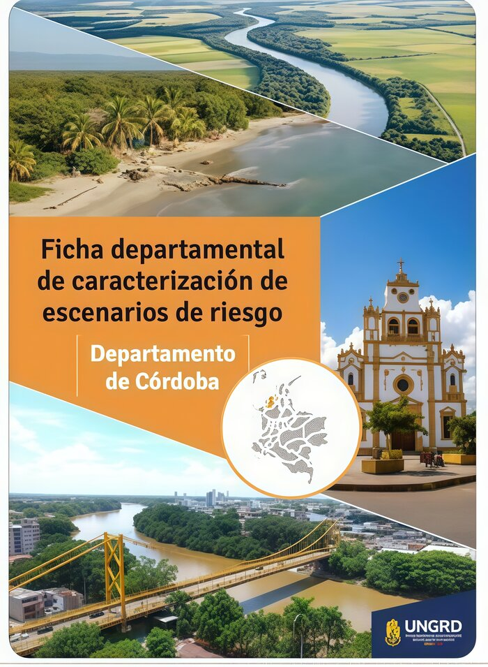

```{=html}
<style>#title-block-header { display: none !important; }</style>

<!-- HERO -->
<section class="nature-hero-section">
  <div class="nature-hero-container">
    <div class="nature-hero-content">
      <h1 class="nature-hero-title">Fichas Departamentales de Caracterización de Escenarios de Riesgo</h1>
      <p class="nature-hero-description">
        Las Fichas Departamentales de Caracterización de Escenarios de Riesgo son documentos
        técnicos elaborados por la Subdirección de Conocimiento del Riesgo de la UNGRD,
        que sintetizan los principales escenarios de riesgo de cada departamento de Colombia. Integran
        información sobre amenazas naturales y socionaturales, elementos expuestos, condiciones de
        vulnerabilidad y capacidades institucionales para la gestión del riesgo.
      </p>
      <div class="nature-hero-stats">
        <div class="stat-item">
          <span class="stat-num">1</span>
          <span class="stat-label">Ficha departamental disponible</span>
        </div>
        <div class="stat-item">
          <span class="stat-num">32</span>
          <span class="stat-label">Departamentos de Colombia</span>
        </div>
      </div>
    </div>

    <div class="nature-hero-visual">
      
    </div>
  </div>
</section>

<!-- DEPARTAMENTOS -->
<div id="departamentos" class="section-wrapper">
  <div class="section-header">
    <h2 class="section-title">Departamentos</h2>
    <div class="section-divider"></div>
  </div>

  <div class="dept-grid">
    <!-- CÓRDOBA — ACTIVO -->
    <div class="dept-card dept-card--active">
      <div class="dept-card__cover">
        
      </div>
      <div class="dept-card__body">
        <h3 class="dept-card__name">Córdoba</h3>
        <p class="dept-card__desc">Inundaciones, avenidas torrenciales y movimientos en masa.</p>
      </div>
      <div class="dept-card__footer">
        <a class="btn-dept-active"
           href="https://scr-ungrd.github.io/fichas-departamentales-escenarios-riesgo-cordoba/"
           target="_blank"
           id="btn-cordoba">
          Explorar Ficha <i class="bi bi-arrow-right-short"></i>
        </a>
      </div>
    </div>
  </div>
</div>

<!-- JS: Enrutamiento local ↔ producción -->
<script>
(function () {
  // Detecta si estamos en entorno local (quarto preview)
  var isLocal = ['localhost', '127.0.0.1', ''].includes(window.location.hostname);
  document.querySelectorAll('[data-href-local]').forEach(function (el) {
    var url = isLocal ? el.getAttribute('data-href-local') : el.getAttribute('data-href-prod');
    if (url) {
      el.setAttribute('href', url);
      if (!isLocal) el.setAttribute('target', '_self');
    }
  });
})();
</script>
```
